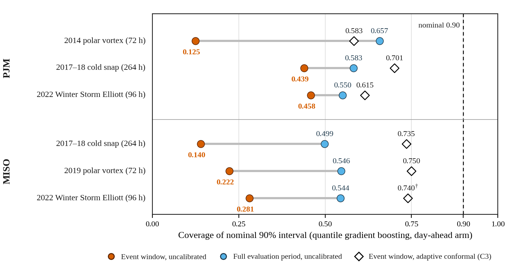

# PJM and MISO Cold-Spell Calibration Benchmark

**When Cold-Spell Calibration Fails to Transfer: A PJM and MISO Benchmark of Probabilistic Load Forecasting in Extreme Cold**

This repository contains the code, frozen protocol, derived data and full results for a benchmark
of probabilistic load forecasting under extreme cold. It asks a narrow question: can calibration
learned from cold weather observed *before* an extreme-cold event be transferred to that event,
under evaluation rules that respect what was knowable at the time?

The primary benchmark covers four PJM extreme-cold events — the January 2014 polar vortex,
February 2015 (an official-forecast error anchor only), the December 2017 – January 2018 cold snap
and Winter Storm Elliott (December 2022). Three forecasters (quantile gradient boosting,
linear-leaf LightGBM, a statistical location–scale model) are combined with five conformal-style
calibrators plus uncalibrated and proportionally expanded baselines, at a day-ahead horizon
(primary) and a one-hour oracle horizon, and judged twice: under strictly chronological evaluation
and under retrospective leave-one-event-out (LOEO) transfer. Version 1.1.0 adds a pre-specified
replication on MISO, a forecast-temperature sensitivity arm and the prior-winter calibration
sensitivity.

The design, event definitions, data splits, calibrator formulas and judgements were frozen in
writing before the primary results were computed (`preregistration/`). These files have no external
timestamp, so we describe the protocol as pre-specified rather than registered.



## Headline findings

- **Collapse.** Uncalibrated 90% intervals cover far fewer hours inside the events than over the
  full evaluation periods. Day-ahead quantile boosting: PJM 0.125 / 0.439 / 0.458 against
  0.657 / 0.583 / 0.550; MISO 0.140 / 0.222 / 0.281 against 0.499 / 0.546 / 0.544. Event coverage is
  below full-period coverage in all six events. In PJM the strictest form of the criterion
  (≥10 pp in all three events) narrowly missed on Elliott (+9.2 pp); in MISO it holds in all three.
- **Repair fails.** No calibrator selected without the target event passes the repair test
  (coverage within ±5 pp of nominal plus frontier, width and placebo conditions): 0 of 6
  learner × horizon cells in PJM and 0 of 6 in MISO.
- **Retrospective and chronological evaluation disagree.** In PJM, LOEO evaluation overstates the
  temperature-stratified Mondrian calibrators' mean event coverage by +11.6 and +21.2 pp
  (day-ahead, quantile boosting). In MISO the gaps are as large per event but change sign
  (means −4.0 and −5.3 pp), so the *direction* of the PJM bias does not replicate; the instability
  of LOEO numbers does.
- **Forecast temperature.** Replacing ERA5 temperature by archived GFS day-ahead forecasts for
  Elliott leaves uncalibrated event coverage unchanged in both systems (PJM 0.458, MISO 0.281).
- **The operator's own record.** PJM's day-ahead forecasts underestimated the peak of all four
  PJM events: −2,545 MW (−1.8%) in January 2014, −1,909 MW (−1.3%) in February 2015,
  −5,361 MW (−3.9%) in the 2017–18 snap and −8,878 MW (−6.6%) during Elliott. The EIA-930
  forecast for MISO missed by −3.8%, +4.6% (2019, a day with load management) and −2.8%.

## Repository layout

| Path | Contents |
|---|---|
| `preregistration/` | The frozen protocol (FREEZE_PROTOCOL v2 + Amendment A1) and the formula specification (METHODS_FORMULAS v2.1) that the code implements. |
| `code/` | The full experiment pipeline: data builders, preparation, learners, calibrators, fit jobs, LOEO transfer, reporting; the Run-1 report (`RESULTS_RUN1.md`); and the tidy result tables in `code/results/` (`results_matrix.csv`, `pinball_by_tau.csv`, per-cell fragments). |
| `data/events/` | Derived hourly PJM load series (from EIA-930) and ERA5 footprint-mean weather series (from the Open-Meteo archive) for the 2018/2022 eras. |
| `data/regen/` | Regenerated 2014 QR-GBT quantile forecasts for the full test year 2014, with their metric set. |
| `data/era2014/` | Placeholder and instructions for the assembled 2014 modelling table, which is not redistributed (see `DATA_SOURCES.md`). |
| `replication_miso/` | Amendment A4: pre-specified MISO replication — plan with SHA-256, code, derived data, results and verdict. |
| `sensitivity_forecast_temperature/` | Amendment A3 (post hoc): GFS forecast temperature for the 2022 era of PJM and MISO. |
| `code/job_mw.py`, `code/results/frag_mw_*` | Amendment A2: prior-winter calibration history sensitivity. |
| `ensemble_spread_c5/` | Amendment A5: pre-specified test of an ensemble-spread calibrator (C5) on archived GEFS; plan published before any data were downloaded, code, extracted GEFS temperatures and results (all criteria fail). |
| `figures/` | Every manuscript and supplement figure, with the scripts and plotted data that draw them (see `figures/README.md`). |
| `DATA_SOURCES.md` | Provenance of every dataset and how to rebuild each one from the public sources. |

## Reproducing the results

Requirements: Python 3.11+ with `numpy`, `pandas`, `scikit-learn`,
`lightgbm` and `scipy` (see `requirements.txt`). The reference run used
scikit-learn 1.5.0, pandas 2.1.4 and numpy 1.26.2; the seed is fixed
(42) throughout.

```bash
pip install -r requirements.txt

# 1. Data (2018/2022 derived series are already in data/events/;
#    to rebuild them from the raw sources, see DATA_SOURCES.md)
python code/build_data_events.py    # event windows (needs data/events/_raw_eia930/)
python code/build_data_spans.py all # training spans + evaluation windows

# 2. Build the 2014 modelling table per DATA_SOURCES.md and place it in
#    data/era2014/ (required for the 2014 era and for step 3)

# 3. Optional: regenerate the 2014 QR-GBT forecasts (data/regen/)
python code/regen_qr_gbt.py

# 4. Prepare era frames, fit all cells, run LOEO transfer, write the report
python code/prep_data.py
bash   code/run_seq.sh              # or code/run_all.sh for the parallel driver
#    (run_seq.sh calls code/job_fit.py per cell, then code/phase2_loeo.py
#     and code/report.py, regenerating code/results/*.csv and the report)
```

## Data

All inputs come from public sources: PJM metered load and PJM published
day-ahead load forecasts, the U.S. EIA Form 930 hourly balancing-authority
files, and ERA5 reanalysis served by the Open-Meteo archive. The derived
series computed from them are included under the repository license;
the assembled 2014 modelling table is documented but not redistributed.
Full details, including known measurement-basis differences (EIA-930
demand vs PJM metered load), are in `DATA_SOURCES.md`.

## Citation

If you use this benchmark, please cite the software using `CITATION.cff`
in this repository. Archived releases are deposited on Zenodo (concept DOI 10.5281/zenodo.24010849).

## License

MIT — see `LICENSE`. Input data remain under their original terms
(EIA-930: U.S. government public data; ERA5: Copernicus / CC BY 4.0;
PJM data: PJM's published data terms).

## Contact

Dresden Goehner, Independent Researcher, Jurupa Valley, CA, USA —
dresdengoehner@outlook.com
